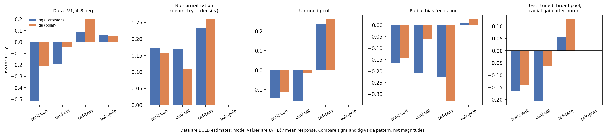
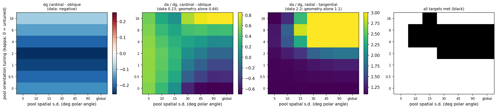
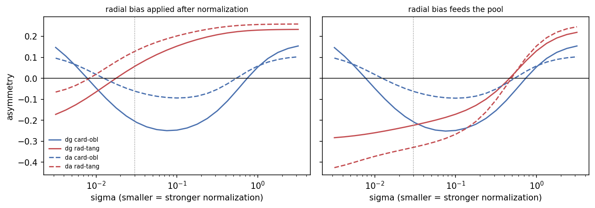
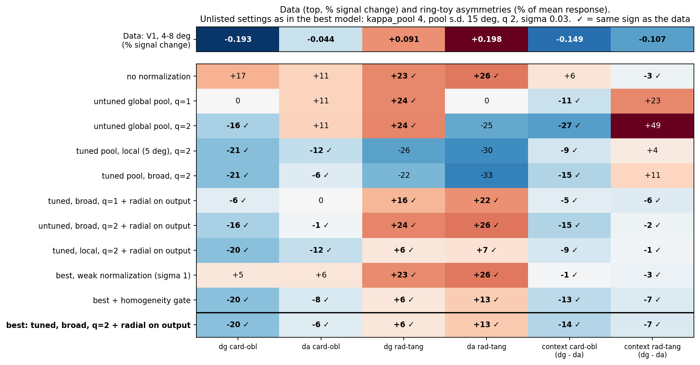

# A toy model of the cardinal and radial BOLD paradoxes

Written 2026-10-22 in the "Toy model" tab of the shared Claude Doc *Models of the cardinal and radial
BOLD paradoxes*, and copied here on 2026-11-12 so that the write-up sits next to the code. The two
companion write-ups are [`../PARADOXES.md`](../PARADOXES.md) (the steerable-pyramid models) and
[`../shared_norm/RESULTS.md`](../shared_norm/RESULTS.md) (both models run through one shared
normalization back end).

## Summary

A small model with no images reproduces all three paradoxes qualitatively, and it shows which parts
are needed. It runs in about 10 seconds for 2,880 parameter settings.

The three paradoxes, from V1 at 4–8° (`Reproduction/RESULTS.md`, section 2):

1. Cardinal orientations are over-represented in V1, yet they give a **weaker** BOLD response
   (dg cardinal − oblique = −0.193; horizontal − vertical = −0.514).
2. Radial orientations are also over-represented, but they give a **stronger** response
   (radial − tangential = +0.091 in dg, +0.198 in da).
3. Both effects **depend on context**. The cardinal effect is much stronger with Cartesian gratings
   (dg/da ratio 4.3). The radial effect is about twice as large with polar gratings (da/dg ratio 2.2).

The model reproduces the full pattern only when four things hold together:

- **The cardinal and horizontal over-representation feeds the normalization pool.**
- **The pool is sharply tuned in orientation and broad in space.** It must cover more than about 10°
  of polar angle (about 1° of visual angle on the ring at 6°).
- **Normalization is strong, within a band.** Too weak and nothing inverts; far too strong and the
  pattern reverses again.
- **The radial bias does not feed the pool.** It acts like a gain applied after normalization. If
  radial units feed the pool the same way cardinal units do, the radial effect inverts with polar
  gratings. That is the opposite of the data.

Homogeneity gating made no difference. A superlinear exponent on the pool (q = 2) is needed for the
radial context effect to exceed what wedge geometry alone gives, unless narrower cardinal tuning or
extra cardinal weight in the pool is added instead. These conclusions held for every size of density
bias tested, from 0.05 to 0.3.

**Later caution (2026-10-23).** Both this model and the pyramid models have since been run through
one shared normalization back end, so that their components are defined the same way
([`../shared_norm/RESULTS.md`](../shared_norm/RESULTS.md)). That confirms most of the conclusions
here. One exception: the radial context effect explained in "Why it works", point 3, depends on the
long tails of this model's tuning curves, and the pyramid does not reproduce it.

## The toy model

V1 is represented as a ring of 72 locations around the stimulus annulus (one every 5° of polar angle)
× 36 orientation channels. There are no images and no spatial frequency. Each part of the model is a
switch that can be turned on or off:

| Part | What it does | Values swept |
|---|---|---|
| Unit density | More units prefer horizontal (`a_hv`), cardinal (`a_card`) and radial (`a_rad`) orientations. The radial term rotates with polar angle. | 0.10 / 0.15 / 0.15; robustness check 0.05–0.3 each |
| Stimulus | dg: one orientation everywhere. da: orientation fixed relative to radial, so it rotates around the ring. Four of each. | — |
| Tuning | Von Mises on doubled angle, half-width about 35°. Optionally narrower for cardinal preferences (`b_card`). | `b_card` 0, 0.3 |
| Normalization | Response = drive² / (σ² + pool^q). The pool is the density-weighted drive, summed over nearby locations and orientations. | σ 1 to 0.01; q 1, 1.5, 2 |
| Pool tuning | Weight on other orientations (von Mises; 0 = untuned). | `kappa_pool` 0, 1, 4 |
| Pool extent | Gaussian over polar angle along the ring. | s.d. 5°, 15°, 45°, global |
| Homogeneity gate | The surround counts only as far as its stimulus orientation matches the centre's. | off, on |
| Pool anisotropy | Extra cardinal weight in the pool only. | `a_pool` 0, 0.3 |
| Where the radial bias acts | `density`: radial units also feed the pool. `output`: radial gain applied after normalization. | both |

**BOLD** at a location is the density-weighted sum of unit responses. Responses are averaged over each
45° wedge and labelled by the orientation at the wedge centre, as in `meanBOLDpa`. The four
asymmetries are then computed as in the paper, each as (A − B) / mean response.

The model is meant to test signs and the dg-versus-da pattern, not magnitudes. Nothing is fit to the
data.

## Results

Only a model with a tuned, spatially broad pool and a radial gain applied after normalization matches
the data's signs and its dg-versus-da pattern (Figure 1, right).

*Figure 1. The four asymmetries in the data (left) and in four versions of the model. Blue = dg
(Cartesian), orange = da (polar). Compare signs and the dg-versus-da pattern; magnitudes are not fit.
With no normalization, every over-represented orientation gives a stronger response. With an untuned
pool, the cardinal effect inverts, but the radial effect is no larger in da. If the radial bias feeds
the pool, the radial effect inverts, most of all in da.*

**Context effects beyond geometry.** Part of any dg-versus-da difference comes from wedge geometry. A
dg grating is exactly radial only at the wedge centre, and a da grating is exactly cardinal only at
the wedge centre. With no normalization, geometry alone gives da/dg ratios of 0.64 (cardinal −
oblique) and 1.1 (radial − tangential). The data show 0.23 and 2.2. So the strict test asks for a
ratio below 0.5 for cardinal and above 1.5 for radial. 63 of the 2,880 settings pass every test.

| Removed or changed, starting from the best model | Which target breaks |
|---|---|
| No normalization | Cardinal and horizontal no longer inverted; context effects back to geometry |
| Untuned or weakly tuned pool | Radial context effect too small |
| Local pool (s.d. 5°) | Both context effects too small |
| Radial bias feeds the pool | Radial effect inverts in da |
| Weak normalization (σ = 1) | Cardinal and horizontal no longer inverted |
| Standard exponent (q = 1) | Radial context effect too small |
| No cardinal, horizontal or radial density bias | The matching effect disappears |
| Add the homogeneity gate | Nothing |

The best model uses `kappa_pool` 4, pool s.d. 15°, q = 2 and σ = 0.03. The other two settings that
matter are shown in Figures 2 and 3.

*Figure 2. Pool orientation tuning (rows) against spatial extent (columns), for the best model. The
dg cardinal effect (first panel) does not depend on spatial extent, because a dg grating has the same
orientation everywhere. The context effects need a pool that is tuned (kappa of about 2 or more) and
broad (s.d. above about 10°). Black = every target met.*

*Figure 3. Asymmetries against normalization strength (smaller σ = stronger). Left: the radial bias
acts after normalization. The data pattern (dg cardinal below zero; radial above zero and larger in
da) holds for σ between about 0.02 and 0.3. Right: the radial bias feeds the pool, and radial −
tangential goes negative whenever cardinal − oblique does.*

*Figure 4. Sign table, in the same layout as Figure 1 of [`../PARADOXES.md`](../PARADOXES.md). Top
row: the data (V1, 4–8°, % signal change), on its own colour scale. Below: toy-model asymmetries (% of
mean response); settings not named in a row are those of the best model (bottom row). The two sets of
numbers are in different units, so compare signs, not sizes. Every q = 2 variant with the radial bias
on the output and strong normalization gets all six signs right, whether its pool is tuned or
untuned, local or broad. Sign checks alone cannot separate those variants: even no normalization gets
the radial context sign right, from wedge geometry alone. The stricter beyond-geometry tests in the
ablation table above are what single out the tuned, broad pool with q = 2.*

## Why it works

Three separate mechanisms do the work, one per paradox.

**1. Why an over-represented orientation can give a weaker response.** More units at an orientation
add to both the numerator and the pool. With an *untuned* pool and the standard exponent (q = 1), the
two cancel at high contrast: the advantage shrinks to zero but never reverses. It reverses when the
pool grows faster than the drive (q > 1). It also reverses with q = 1 if the pool is *tuned*. A unit
just off the cardinal axis is then divided by a pool centred on the denser cardinal channels, so it
is over-suppressed; near the obliques the reverse happens.

**2. Why the radial bias must not feed the pool.** With polar gratings (da), a radial stimulus matches
the dense radial units at *every* location. To the pool, that is the same situation as a cardinal
Cartesian grating in dg. So any pool that suppresses cardinals in dg also suppresses radial stimuli
in da, in all 1,440 settings tested. The data show the opposite. In the model, the radial bias has to
act after normalization.

**3. Why the effects depend on context.** A tuned, spatially broad pool is stronger when the whole
field has one orientation (dg) than when the orientation rotates around the annulus (da). In the best
model, the pool at the stimulus orientation is about 20% larger in dg. Stronger normalization
flattens the population response: its half-width is 125–135° in dg against 50–75° in da. A flatter
population response does two things:

- The cardinal penalty is larger in dg, because the uniform cardinal field fills the pool.
- A radial gain applied afterwards is diluted in dg, because the response is spread over many
  orientations. So the radial effect is larger in da.

This is close to iso-orientation surround suppression, which is stronger when the surround matches
the centre's orientation. Homogeneity gating adds nothing here, because a sharply tuned pool already
ignores a surround of a different orientation.

## Limits and caveats

- **Magnitudes are not fit.** The model gets the signs and the dg-versus-da pattern, but its
  horizontal − vertical effect in dg (−0.16) is much smaller relative to the others than in the data
  (−0.51).
- **Polar-cardinal versus polar-oblique is zero in the model.** The data show +0.056 in dg. Nothing in
  the model distinguishes spirals from radial and tangential gratings except through the radial term.
- **No images, so no vignetting.** Aperture edges alone can create large orientation biases in fMRI
  (Roth, Heeger & Merriam, 2018). The model cannot test whether the radial effect comes from the
  aperture rather than from neurons. The steerable-pyramid analysis did test it: the aperture edges
  are far from 4–8°, and with a balanced population the radial effect for Cartesian gratings is 0.0%.
- **Static gratings only.** The model simulates the four stationary gratings, which are the only
  conditions the paper analyses. The experiment's eight motion-direction conditions are not modelled.
- **BOLD is taken as the sum of unit responses.** Any nonlinearity between neural activity and BOLD is
  ignored.
- **The cardinal density bias may be limited to some cells.** In cat V1, both the extra cardinal cells
  and the narrower horizontal tuning were mainly in simple cells tuned to high spatial frequencies
  (Li, Peterson & Freeman, 2003). Complex cells did not show them.
- **"Radial gain after normalization" is a stand-in.** It means any radial bias that does not enter
  the suppressive pool. It could be a feedback or output gain, or an effect of the stimulus aperture.
  The model cannot tell these apart; that is a guess about what the switch stands for, not a result.

## How this relates to the steerable-pyramid models

The toy agrees with the pyramid models where they overlap, and it suggests one change to them. The
full pyramid-model analysis is in [`../PARADOXES.md`](../PARADOXES.md); the matched comparison of the
two is in [`../shared_norm/RESULTS.md`](../shared_norm/RESULTS.md).

- **Agreement.** `Models/SUMMARY.md` reports that only model 2, the superlinear pool (`q_exp = 2`),
  reproduces the cardinal suppression, and only for Cartesian gratings. The toy finds the same: q > 1
  or a tuned pool is needed, and the effect is strongest in dg.
- **The likely problem.** In the notebook, `imposeImbalance` multiplies the energy by the cardinal
  *and* radial gains *before* normalization. So the radial bias feeds the pool. The toy predicts that
  this setup inverts the radial effect with polar gratings. A separate rerun of the pyramid models
  found that too: model 2 weakens or inverts the radial effect in da under strong normalization.
- **A sign to check.** `SUMMARY.md` (step 5) describes the goal as a *suppressed* net response for
  both cardinal and radial. The data show radial responses are *larger*. The radial target should
  probably be enhancement, not suppression.

**Suggested changes to try in the pyramid models:**

1. Apply the radial gain after normalization, and keep the cardinal gain before it. The separate
   rerun found that this was its best variant too.
2. Use a pool that is narrowly tuned in orientation and broad in space. With four orientation
   channels the pool cannot be sharply tuned; eight or more channels may be needed.
3. Check that the result holds over a band of normalization strengths, not at one σ.

**Predictions for lower contrast.** Lowering contrast weakens normalization, and the model then makes
three predictions. If any data at lower contrast exist, they are a direct test.

| Contrast | dg cardinal − oblique | dg radial − tangential | da radial − tangential | da/dg, radial |
|---|--:|--:|--:|--:|
| 1 (as fit) | −0.21 | +0.06 | +0.13 | 2.3 |
| 0.3 | −0.15 | +0.21 | +0.24 | 1.2 |
| 0.2 | 0.00 | +0.23 | +0.26 | 1.1 |
| 0.05 | +0.17 | +0.23 | +0.26 | 1.1 |

1. **The cardinal penalty should shrink and then reverse.** Cardinal responses become stronger than
   oblique ones once normalization is weak (below about 0.2 of the contrast used here).
2. **The radial advantage should not go away. It should grow.** Radial − tangential stays positive at
   every contrast, in both experiments.
3. **The radial context effect should shrink to what geometry alone gives** (da/dg ratio about 1.1),
   because the dg-versus-da difference comes from normalization.

Prediction 2 holds in both versions of the model, whether or not the radial bias feeds the pool. So
it does not tell them apart; the high-contrast data already do. What it adds is a dissociation: the
two over-representations should behave in opposite ways as contrast changes.

## Files and how to rerun

Everything needs only Python 3 with NumPy and Matplotlib, and the whole set runs in under a minute.

| File | What it does |
|---|---|
| `ring_toy.py` | The model, the four asymmetries and the targets |
| `sweep.py` | The 2,880-setting sweep; writes `sweep_results.csv` |
| `figures.py` | The ablations and Figures 1–3 (run after `sweep.py`) |
| `robustness.py` | Repeats the key part of the sweep for density biases from 0.05 to 0.3 |
| `sign_table.py` | Figure 4, the sign table |

Run `python3 sweep.py`, then `python3 figures.py`, from inside `Models/ring_toy/`.

## Sources

- Benucci, Saleem & Carandini (2013). Adaptation maintains population homeostasis in primary visual
  cortex. *Nat Neurosci* 16:724–729. [doi:10.1038/nn.3382](https://doi.org/10.1038/nn.3382)
- Coen-Cagli, Kohn & Schwartz (2015). Flexible gating of contextual influences in natural vision.
  *Nat Neurosci* 18:1648–1655. [doi:10.1038/nn.4128](https://doi.org/10.1038/nn.4128)
- Essock, Haun & Kim (2009). An anisotropy of orientation-tuned suppression that matches the
  anisotropy of typical natural scenes. *J Vis* 9(1):35. [doi:10.1167/9.1.35](https://doi.org/10.1167/9.1.35)
- Li, Peterson & Freeman (2003). Oblique effect: a neural basis in the visual cortex. *J Neurophysiol*
  90:204–217. [doi:10.1152/jn.00954.2002](https://doi.org/10.1152/jn.00954.2002)
- Roth, Heeger & Merriam (2018). Stimulus vignetting and orientation selectivity in human visual
  cortex. *eLife* 7:e37241. [doi:10.7554/eLife.37241](https://doi.org/10.7554/eLife.37241)
- Sasaki et al. (2006). The radial bias: a different slant on visual orientation sensitivity in human
  and nonhuman primates. *Neuron* 51:661–670.
  [doi:10.1016/j.neuron.2006.07.021](https://doi.org/10.1016/j.neuron.2006.07.021)

References retrieved from PubMed. Data values are from `Reproduction/RESULTS.md`, section 2.
