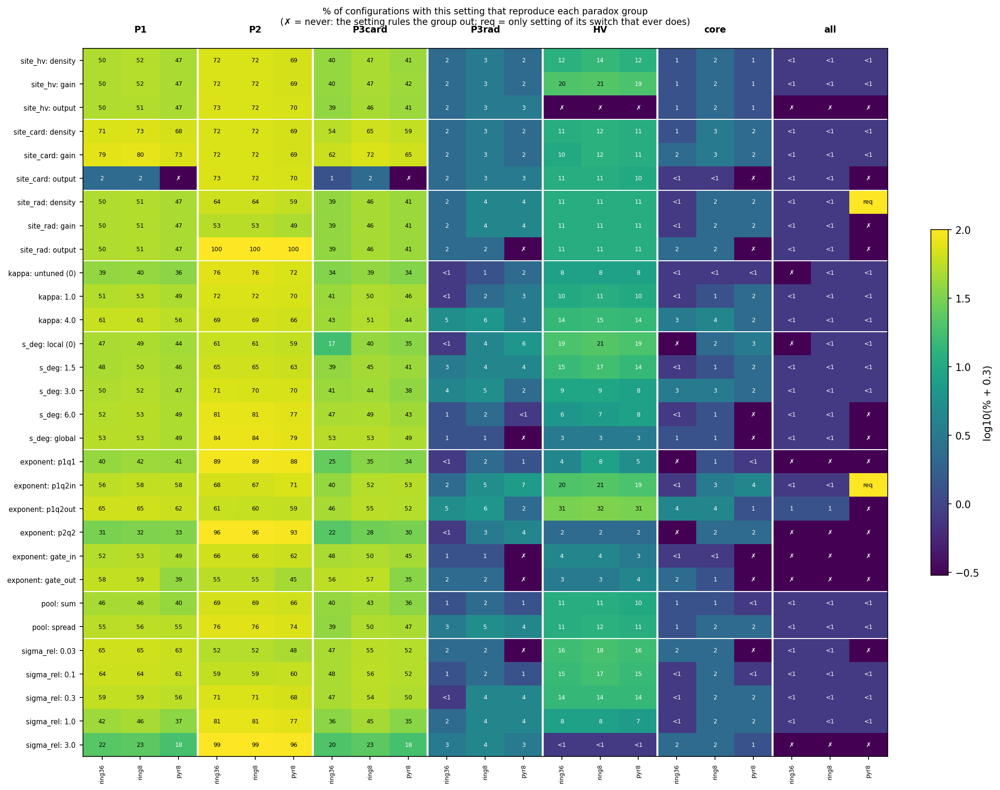
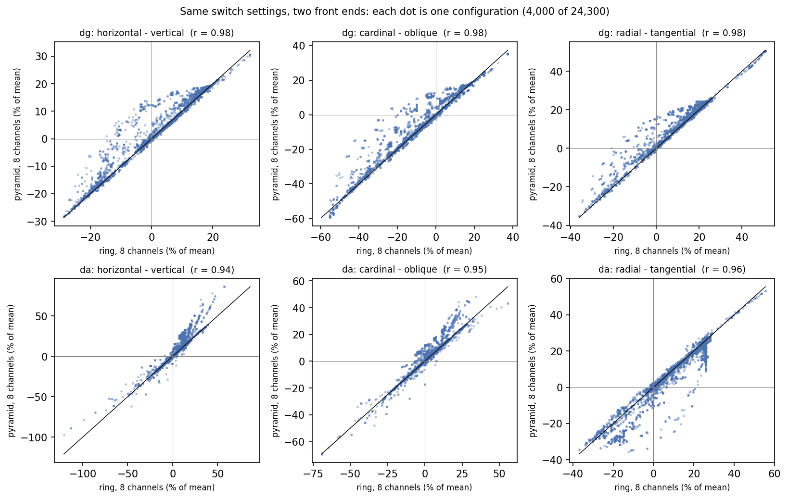

# Shared normalization: one back end, two front ends

The ring toy and the pyramid models disagreed in places. But they also defined their parts
differently, so their conclusions could not be compared part by part. Here both are run through
**one** normalization back end, with every model component defined the same way, and through
**one** factorial design. Written 2026-10-23. All code is new and is in this folder; Rania's model
code and the two earlier analyses are unchanged.

This is a **qualitative** analysis. It asks which components *can* produce each pattern, and which
rule it out. It is not a fit to the data.

## The paradoxes, as scored here

`dg` = Cartesian gratings, `da` = polar gratings. Data: V1, 4–8°, matched 7 observers, % signal change.

| | dg | da |
|---|--:|--:|
| horizontal − vertical | −0.514 | −0.212 |
| cardinal − oblique | −0.193 | −0.044 |
| radial − tangential | +0.091 | +0.198 |

Every front end is scored with the same targets:

| group | passes when |
|---|---|
| **P1** | dg cardinal < oblique |
| **P2** | radial > tangential in both experiments |
| **P3card** | P1, and the cardinal deficit is smaller in da, and da is less than half of dg |
| **P3rad** | P2, and radial − tangential is larger in da, and da > 1.5 × dg |
| **HV** (scored separately) | horizontal < vertical in dg and in da, and more negative in dg |
| **core** | P1, P2, P3card and P3rad together |
| **all** | core and HV |

The "half" and "1.5 ×" conditions are the toy's "beyond geometry" targets. Stimulus geometry alone
gives a da/dg ratio of about 0.6 for cardinal − oblique and about 1.1 for radial − tangential, so a
model must do more than geometry to pass them.

## The matched table

Each cell is the **% of configurations with that setting that pass the group**, for the three
front ends in the order **ring36 / ring8 / pyr8**. **✗ means never**: that setting rules the group
out on that front end.

| component | P1 | P2 | P3card | P3rad | HV |
|---|---|---|---|---|---|
| cardinal bias at output | 2 / 2 / ✗ | 73 / 72 / 70 | 1 / 2 / ✗ | 2 / 3 / 3 | 11 / 11 / 10 |
| cardinal bias as unit density | 71 / 73 / 68 | 72 / 72 / 69 | 54 / 65 / 59 | 2 / 3 / 2 | 11 / 12 / 11 |
| cardinal bias as input gain | 79 / 80 / 73 | 72 / 72 / 69 | 62 / 72 / 65 | 2 / 3 / 2 | 10 / 12 / 11 |
| horizontal bias at output | 50 / 51 / 47 | 73 / 72 / 70 | 39 / 46 / 41 | 2 / 3 / 3 | **✗ / ✗ / ✗** |
| radial bias at output | 50 / 51 / 47 | **100 / 100 / 100** | 39 / 46 / 41 | 2 / 2 / **✗** | 11 / 11 / 11 |
| radial bias as unit density | 50 / 51 / 47 | 64 / 64 / 59 | 39 / 46 / 41 | 2 / 4 / 4 | 11 / 11 / 11 |
| untuned pool (κ = 0) | 39 / 40 / 36 | 76 / 76 / 72 | 34 / 39 / 34 | <1 / 1 / 2 | 8 / 8 / 8 |
| tuned pool (κ = 4) | 61 / 61 / 56 | 69 / 69 / 66 | 43 / 51 / 44 | 5 / 6 / 3 | 14 / 15 / 14 |
| local pool | 47 / 49 / 44 | 61 / 61 / 59 | 17 / 40 / 35 | <1 / 4 / 6 | 19 / 21 / 19 |
| global pool | 53 / 53 / 49 | 84 / 84 / 79 | 53 / 53 / 49 | 1 / 1 / **✗** | 3 / 3 / 3 |
| p = q = 1 | 40 / 42 / 41 | 89 / 89 / 88 | 25 / 35 / 34 | <1 / 2 / 1 | 4 / 8 / 5 |
| q = 2 > p (outside the pool) | 65 / 65 / 62 | 61 / 60 / 59 | 46 / 55 / 52 | 5 / 6 / 2 | 31 / 32 / 31 |
| gated exponent (M5) | 58 / 59 / **39** | 55 / 55 / 45 | 56 / 57 / **35** | 2 / 2 / **✗** | 3 / 3 / 4 |
| spread pool (M4) | 55 / 56 / 55 | 76 / 76 / 74 | 39 / 50 / 47 | 3 / 5 / 4 | 11 / 12 / 11 |
| weak normalization (σ = 3 × pool) | 22 / 23 / 18 | 99 / 99 / 96 | 20 / 23 / 18 | 3 / 4 / 3 | <1 / <1 / <1 |

The gated-exponent row is the version with q outside the pool; q inside behaves the same way.

**How often the whole pattern passes.**

| | ring36 | ring8 | pyr8 |
|---|--:|--:|--:|
| core passes (of 24,300) | 274 | 455 | 318 |
| all (core + HV) passes | 55 | 74 | 34 |

76 configurations pass core on all three front ends; 2 pass all.



*Figure 1. The full matched table: every level of every switch. Colour is the pass rate on a log scale.*

## What changed, and how each part is defined now

The table below shows how each part was defined in the two earlier analyses, and the single
definition used here.

| | ring toy | pyramid models | shared back end |
|---|---|---|---|
| where an over-representation enters | unit density (extra units; they feed the pool) | a gain on energy, before the exponent | one of three **sites**, set separately for horizontal, cardinal and radial: *unit density*, *input gain* (before the exponent) or *output* (after normalization; never reaches the pool) |
| "tuned" pool | von Mises weights across orientation | M3: own channel pooled in space, plus an **equal, local sum of all other channels** | von Mises weights; κ = 0 (untuned), 1 or 4 |
| orientation channels | 36 | 4 | ring with 36 and with 8; pyramid with **8** |
| pool types | weighted sum only | sum (M1–M3), spread across orientation (M4), gated exponent (M5) | sum or spread; each with or without the gated exponent |
| pool size | degrees of polar angle | visual degrees | **visual degrees**. The ring sits at 6°, so the toy's 15° of polar angle is 1.57°. |
| where q applies | outside the pool: (Σ drive)^q | inside: Σ (drive^q) | both, as separate settings |
| σ | absolute | absolute, at 100% contrast | **a multiple of the mean pool**, so "strong normalization" means the same thing on every front end |

**The model in one line.** Response = readout weight × (gain × energy)^p ÷ (σ + pool). BOLD at a
location is the mean response over all channels. The readout is the same for every front end: the
mean in each 45° wedge at 4–8°, with each asymmetry divided by that experiment's mean response.

**Checks.** With matching settings, the back end reproduces every earlier model
([`check_backend.py`](check_backend.py)):

- Rania's M1–M5 (the repo functions, called unchanged): largest relative error 5 × 10⁻⁶.
- The repo's `imposeImbalance`: exact.
- `ring_toy.respond` at the toy's default, its best model and seven variations: exact (10⁻¹⁵).
- Averaging pyramid energy in 4 × 4 blocks, done to make the factorial fast enough to run, moves every asymmetry by less than 0.05 percentage points.

**The three front ends.**

- **ring36**: the ring toy as written.
- **ring8**: the same ring with 8 orientation channels. Comparing it with ring36 isolates
  orientation resolution.
- **pyr8**: steerable-pyramid energy of the model stimuli, with 8 orientation channels and 6
  spatial-frequency channels, at the experiment's 50% contrast.

The pyramid's polar gratings are set to 1 cpd at 6°, as in the experiment. The experiment's own
rule gives 38 cycles around the circle. The notebook set them at 7.2°. With 8 channels, the
pyramid's orientation tuning has a half-width of 18°, against 17° for the toy, so the two front
ends have nearly the same orientation bandwidth.

**The design.** Every combination of the following, 24,300 configurations per front end, plus
no normalization:

- the site of each bias (3 × 3 × 3);
- pool tuning κ: 0, 1 or 4;
- pool s.d.: 0 (local), 1.5, 3 or 6°, or global;
- exponents: p = q = 1; q = 2 inside; q = 2 outside; p = q = 2; gated inside; gated outside;
- pool type: sum or spread;
- σ: 0.03, 0.1, 0.3, 1 or 3 × the mean pool.

The bias sizes are the toy's: horizontal 1 ± 0.10, cardinal 1 ± 0.15 and radial 1 ± 0.15. The
pyramid run took 18 minutes; each ring run took 2.

## Where the two front ends agree

**Most of the old disagreement came from the definitions, not from the front ends.** For the same
switch settings, the ring and the pyramid give the same verdict in 94–99% of configurations. The
asymmetry values correlate at r = 0.94–0.98 (Figure 2). With no normalization at all, all eight
asymmetries agree within about 1 percentage point, so the stimulus geometry is the same in both.



*Figure 2. Each dot is one configuration, run on the 8-channel ring (x) and the 8-channel pyramid (y).
The line is equality.*

What now holds on every front end:

1. **The cardinal deficit (P1) needs the cardinal bias to reach the pool.** When the bias enters
   only at the output, P1 almost never appears (2% / 2% / 0%).

2. **"Tuned normalization makes P1 worse" was a property of M3, not of tuning.** An untuned pool
   with equal exponents (p = q) never produces P1, on any front end (0%). The response then
   saturates but never reverses (Heeger 1992). A tuned pool with equal exponents produces P1 in
   70% of such configurations, on all three front ends.

   Why: units tuned near the stimulus orientation are normalized mostly by each other, so extra
   units there cancel out. Units on the flanks are normalized by a pool that includes the
   stimulus peak. For an oblique grating, the peak sits on the less common oblique units, so the
   flanks are suppressed less. For a cardinal grating, the peak sits on the more common cardinal
   units, so the flanks are suppressed more.

   M3 is tuned only in its spatial term. Its cross-orientation term is an equal sum over all
   other channels, so at each location it acts like an untuned pool. The two earlier analyses
   used the word "tuned" for two different pools.

3. **q > p, a tuned pool and strong normalization all help P1.** Suppression that grows faster
   than excitation is supersaturation, which Peirce (2007) found in some macaque V1 neurons. The
   spread pool (M4) also helps.

4. **The radial advantage (P2) is guaranteed if the radial bias stays out of the pool**: 100% on
   all three front ends. When the radial bias feeds the pool, P2 fails in 36–51% of
   configurations. Both earlier analyses found this.

5. **The cardinal context effect (P3card) grows with pool size.** A broad pool mixes the many
   orientations in a polar grating. So it cannot single out the extra cardinal drive, and that
   drive passes through without being suppressed.

6. **The horizontal deficit (HV) needs the horizontal bias to reach the pool**: it never passes
   with the bias at the output. It is helped by q > p and by *local* pools. With a global pool it
   passes in only 3% of configurations.

7. **New: the horizontal deficit and the cardinal context effect pull against each other.** In
   the data, polar gratings still show a strong horizontal deficit (−0.21) but almost no cardinal
   deficit (−0.04). In these models, a horizontal deficit within a polar grating needs suppression
   that stays local. But for the cardinal deficit to vanish in polar gratings, the pool must be
   broad enough to mix orientations. Among configurations that pass P3card, HV passes in about 22%
   with local or 1.5° pools, but only about 6% with global pools. This holds on every front end,
   and it is the main reason the full pattern is rare.

## Where they disagree, and why

1. **The strict radial context target (P3rad).** This is the one real disagreement. With the
   radial bias at the output, the ring passes in 2% of configurations and the pyramid never does.
   The pyramid's best da/dg ratio is 1.49, against 2.7 on the ring.

   The mechanism is the same in both, and it was measured directly. In a Cartesian grating, a
   broad tuned pool sees the same orientation everywhere. So after normalization the population's
   response is spread more evenly across orientation channels, and a radial gain applied after
   normalization is diluted. In a pinwheel, the pool sees all orientations, so the response stays
   concentrated near the stimulus orientation and the radial gain keeps its full effect.

   The ring spreads the response more. Its tuning curves (von Mises) have long, low tails, and
   strong normalization with q = 2 amplifies them. The pyramid's filters have no tails beyond 90°.
   After normalization, the response 45° from the stimulus is 74% of the peak on the ring and 38%
   on the pyramid; before normalization it is 2%. The pyramid's six spatial-frequency channels
   dilute the effect further. Using only its 1 cpd channel raises its ratio from 1.37 to 1.76.

   So **any claim that this mechanism produces P3rad depends on the shape of the tuning-curve
   tails**, which neither model constrains. The toy's own best model passes P3rad on the ring but
   fails it on the pyramid at every pool size of 3° and above.

2. **The gated exponent (M5).** On the pyramid, gating never passes core or P3rad, and it gives
   P1 less often (39% against 58%).

   Part of the reason, measured: a gated exponent depends on the units of energy. For a Cartesian
   grating the pool grows as energy², but for a polar grating only as about energy^1.5, because
   its homogeneity is about 0.5. So the result depends on the energy's arbitrary scale, which
   differs 20-fold between the front ends. Rescaling the pyramid's energy into the ring's units
   raises agreement on a sample of 1,200 gated cases from 91% to 96%.

   The rest of the gap is probably the pyramid's spatial-frequency channels. They lower
   homogeneity for polar gratings (0.46, against 0.53 on the ring). **That is a guess; it was not
   tested separately.** Any M5 result should be read with this dependence on units in mind. M5
   is motivated by homogeneity-gated surround suppression (Coen-Cagli, Kohn & Schwartz 2015).

3. **Broad pools (6° and global) and the smallest σ.** On the pyramid these never pass core; on
   the ring they rarely do (about 1%). The failure goes through P3rad, so this is the same issue
   as point 1.

4. **Orientation resolution matters only at the margins.** The 36-channel and 8-channel rings
   agree in 93–100% of configurations. The largest gap is P3card with a local pool: 17% with 36
   channels, 40% with 8. With 8 channels, cardinal and oblique stimuli fall exactly on channel
   centres; with 36, they also drive the neighbouring channels. So 8-channel results for local
   pools may be somewhat optimistic about P3card.

## One choice matters more than any switch: the readout

The scoring above divides each experiment's asymmetries by **that experiment's** mean response.
This removes any difference in overall response level between Cartesian and polar gratings.

If instead every asymmetry is divided by **one mean shared by both experiments**, so that level
differences are kept, P3rad passes **10 times as often**: 478 → 6,787 configurations on the
36-channel ring, and 607 → 6,757 on the pyramid. Core passes rise in step, from 274 to 2,914 and
from 318 to 2,945. HV passes fall by about a third.

The pyramid write-up noted that its "radial larger in da" came from polar gratings being less
normalized overall. This confirms it: in every model here, most of the radial context effect is
an effect of overall response level.

**Which readout matches the data is a judgement, and what follows is a guess.** The fMRI
asymmetries are differences in % signal change, measured against the same pink-noise blank in
both experiments. They are not divided by each experiment's mean. That suggests the shared-mean
readout is the closer match. But nothing in the data can check the model's overall response
level, because the blank is not a true baseline.

Until that is settled, **P3rad should be treated as unexplained under per-experiment scoring, and
as an overall-level effect under shared scoring.** It should not be credited to any one component.

## Short answer

Defined the same way, the two front ends agree on almost everything:

- The cardinal and horizontal deficits need their bias inside the pool. They are helped by q > p,
  by a tuned pool and by strong normalization.
- Tuned pools help rather than hurt; the opposite earlier result came from how M3 was built.
- Keeping the radial bias out of the pool guarantees the radial advantage.
- The cardinal context effect comes from broad pools, but the horizontal deficit in polar gratings
  needs local pools, so the two pull against each other.

The front ends disagree on the strict radial context effect and on gated exponents. In each case
the cause is something neither model pins down: the shape of the tuning-curve tails, the units of
energy, and whether the readout keeps differences in overall response level.

## Files and reproducing

- `backend.py`: the shared normalization and the shared scoring.
- `frontend_ring.py` and `frontend_pyramid.py`: the two front ends.
- `check_backend.py`: the reproduction checks.
- `factorial.py`: the design.
- `summarize.py`: [`results/tables.md`](results/tables.md), which holds every pass rate, the
  agreement between front ends and three ablation tables, plus both figures.

The figures are PNG files, which this repository ignores by default, so they exist only after
`summarize.py` has been run.

Use Python 3.11 with the repo's Intel-Mac pins. Run from `Models/shared_norm/`:

```bash
python check_backend.py        # ~1 min; first run paradoxes/00_checks.py, which builds the 4-channel energies
python factorial.py ring36     # ~2 min
python factorial.py ring8      # ~2 min
python factorial.py pyr8       # ~18 min on 12 workers; logs progress to _cache/
python summarize.py            # tables and figures
```

## References

- Coen-Cagli R, Kohn A, Schwartz O (2015). Flexible gating of contextual influences in natural
  vision. *Nat Neurosci* 18:1648–1655. [doi:10.1038/nn.4128](https://doi.org/10.1038/nn.4128)
- Fang C, Cai X, Lu HD (2022). Orientation anisotropies in macaque visual areas. *PNAS*
  119:e2113407119. [doi:10.1073/pnas.2113407119](https://doi.org/10.1073/pnas.2113407119)
  (Cardinal and radial over-representation in macaque V1.)
- Heeger DJ (1992). Normalization of cell responses in cat striate cortex. *Vis Neurosci*
  9:181–197. [doi:10.1017/s0952523800009640](https://doi.org/10.1017/s0952523800009640)
- Peirce JW (2007). The potential importance of saturating and supersaturating contrast response
  functions in visual cortex. *J Vis* 7(6):13. [doi:10.1167/7.6.13](https://doi.org/10.1167/7.6.13)
- Sasaki Y et al. (2006). The radial bias: a different slant on visual orientation sensitivity in
  human and nonhuman primates. *Neuron* 51:661–670.
  [doi:10.1016/j.neuron.2006.07.021](https://doi.org/10.1016/j.neuron.2006.07.021)

These are the same sources the pyramid write-up checked on PubMed on 2026-10-21. This analysis
makes no new claims about the literature.
